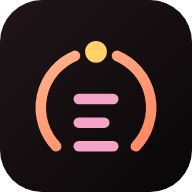

<p align="center">  </p>

# Dayspec

A personal web app for planning daily routines, with reusable templates and shared blocks.

### Features

- **Daily timeline**: Browse dates, see the current activity and spot unplanned time between activities.
- **Templates**: Create and edit routines in the app. Each weekday belongs to at most one template.
- **Shared blocks**: Reuse sequences such as a morning routine. Each activity has a duration; choose the block's start time when adding it to a template.
- **Choices**: Switch between options such as Home and Office to show the appropriate activities.
- **Notes and links**: Add details and links to activities, including Notion pages.
- **Holidays**: Use the Swedish public holiday calendar and choose a holiday template, or toggle the holiday setting for a date.
- **Multiple devices**: Edit on your computer and read on your phone. Saved routines refresh when you return to the app or reconnect.
- **Integrations**: Manage templates, shared blocks and settings through an HTTP API or MCP.

Dayspec can be added to your phone's home screen. A connection to your server is required; routines are not stored for offline use.

## Requirements

- A server with Docker and Docker Compose.
- A Cloudflare account with a domain, for Cloudflare Tunnel and Access in front of the app.

## Install

> [!IMPORTANT]
> The app has no login of its own, including the API and MCP. Protect the entire hostname with Cloudflare Access. Never publish the Dayspec container's port or expose its origin directly: anything that can reach it can read and change your routines.

The provided [`docker-compose.yml`](docker-compose.yml) runs `ghcr.io/agusespa/dayspec:latest` next to `cloudflared`. The tunnel connects out to Cloudflare, so no port needs to be opened on the server or router.

1. Create a folder on your server and download the Compose file:

   ```bash
   mkdir dayspec && cd dayspec
   curl -fsSLO https://raw.githubusercontent.com/agusespa/dayspec/main/docker-compose.yml
   ```

2. In Cloudflare Zero Trust, create a tunnel and copy its tunnel token.
3. Add a public hostname, for example `day.example.com`, pointing to `http://dayspec:8080`.
4. Create a **self-hosted Access application** for that hostname. Add an Allow policy for your email or identity provider. Protect all paths, including `/api/*` and `/mcp`.
5. Create a `.env` file next to `docker-compose.yml`:

   ```dotenv
   TUNNEL_TOKEN=<your tunnel token>
   ```

6. Start the services:

   ```bash
   docker compose up -d
   docker compose ps
   ```

7. Open `https://day.example.com` and sign in through Access. On an iPhone, use Safari's **Share → Add to Home Screen** to install the app.

The app starts with an empty Daily template. Open Templates to add activities, change its weekday assignments, and create more templates for unassigned days. Shared blocks are managed from the routine library; holiday preferences are in Profile.

If you already run `cloudflared`, add Dayspec to its Docker network and use that tunnel instead. Only run trusted services on this network: containers sharing it can reach Dayspec without passing through Access. Use the Cloudflare-protected hostname for your integrations.

### Updating

```bash
docker compose pull && docker compose up -d
```

Reload the app to load its new version. Routine edits are saved on the server and do not require a new image or container restart.

The data volume survives container updates and `docker compose down`. Adding `--volumes` or `-v` to `docker compose down` deletes the volume and its routines.

## Configuration

Set these in the Dayspec service's `environment` section. Both are optional when using the provided Compose file.

| Variable       | Default                  | Purpose                                                                             |
| -------------- | ------------------------ | ----------------------------------------------------------------------------------- |
| `ROUTINE_PATH` | `/app/data/routine.json` | Saved routine library inside the container. Keep it within the mounted data volume. |
| `PORT`         | `8080`                   | Container port. Update the tunnel's service URL if you change it.                   |

Weekday assignments, choices and holiday preferences are configured in the app.

## Data and backups

The provided Compose file stores the routine library in the named Docker volume `dayspec_data`, mounted at `/app/data`. Docker normally prefixes its name with the Compose project name. Templates, shared blocks and settings live in `/app/data/routine.json`; they are not built into the container image.

Per-date choice selections and manual holiday overrides are stored in each browser. They are not shared between devices or included in server backups.

### Back up

Run these commands from the folder containing `docker-compose.yml`:

```bash
mkdir -p backups
umask 077
docker compose cp dayspec:/app/data/routine.json \
  "./backups/routine_$(date +%Y%m%d_%H%M%S).json"
```

You can copy this file while Dayspec is running: saves replace it atomically. Keep a copy of your backups on another device or storage service.

### Restore

Make a fresh backup first. Stop Dayspec, then use a temporary helper container to restore the file into its volume with the ownership the app needs. Replace the example filename with your backup's filename:

```bash
docker compose stop dayspec

docker run --rm \
  --volumes-from "$(docker compose ps -aq dayspec)" \
  --mount "type=bind,src=$PWD/backups,dst=/backups,readonly" \
  busybox:stable sh -c \
  'cp /backups/routine_20261117_020000.json /app/data/routine.json &&
   chown 65532:65532 /app/data/routine.json &&
   chmod 600 /app/data/routine.json'

docker compose up -d dayspec
docker compose exec dayspec /app/dayspec healthcheck
```

These commands use the provided Compose file's default data path. The image runs as UID 65532. Dayspec validates saved data on startup and refuses to start with an invalid file; it does not silently replace it with an empty routine. Restore backups with an app version that supports their schema.

## Monitoring

| Endpoint           | Purpose                                                                                                                                  |
| ------------------ | ---------------------------------------------------------------------------------------------------------------------------------------- |
| `GET /api/healthz` | Liveness: `200` with `{"status":"ok"}` while the server responds.                                                                        |
| `GET /api/readyz`  | Readiness: `200` with `{"status":"ready"}` when the frontend is available, otherwise `503`. Saved routines are validated during startup. |

The container's built-in Docker health check calls `/api/readyz` every 30 seconds. Check it with `docker compose ps`, or run it manually:

```bash
docker compose exec dayspec /app/dayspec healthcheck
```

For startup errors, inspect `docker compose logs dayspec`. Docker does not restart an unhealthy container solely because its health check fails.

## API

Automations such as n8n can read and edit the saved routine library. Use the same Cloudflare-protected hostname as the app. See [Connecting](#connecting) for authentication.

| Endpoint                     | Does                                                                                               |
| ---------------------------- | -------------------------------------------------------------------------------------------------- |
| `GET /api/routine`           | Reads the complete library and its revision.                                                       |
| `PUT /api/routine`           | Replaces the complete library. Anything omitted is deleted. Body: `{"routine": {...}}`.            |
| `GET /api/templates`         | Lists templates by stable ID, with the current revision.                                           |
| `GET /api/templates/{id}`    | Reads one template and the current revision.                                                       |
| `PUT /api/templates/{id}`    | Creates or replaces one template, preserving the rest of the library. Body: `{"template": {...}}`. |
| `DELETE /api/templates/{id}` | Deletes a template; clears the holiday-template setting if it points there.                        |
| `GET /api/blocks`            | Lists shared blocks by stable ID, with the current revision.                                       |
| `GET /api/blocks/{id}`       | Reads one shared block and the current revision.                                                   |
| `PUT /api/blocks/{id}`       | Creates or replaces one block. Body: `{"block": {...}}`.                                           |
| `DELETE /api/blocks/{id}`    | Deletes a block, provided no templates or other blocks reference it.                               |
| `GET /api/settings`          | Reads settings and the current revision.                                                           |
| `PUT /api/settings`          | Replaces all settings. Body: `{"settings": {...}}`.                                                |
| `GET /api/schema`            | Returns the authoritative routine JSON Schema.                                                     |
| `GET /api/openapi.json`      | Returns the OpenAPI description for the HTTP API.                                                  |

Every write needs an `If-Match` header containing the exact `ETag` or `revision` from the latest read or successful write, including its quotation marks. Missing revisions return `428`; stale revisions return `412`. Read again and reconcile your changes before retrying a conflict.

Writes use `Content-Type: application/json` and return the complete saved library with its new revision. Invalid data or references return `422` without changing the library. Requests are limited to 1 MB.

IDs stay the same when display names change. Times use local `HH:MM`; activity durations are minutes. Choice order matters when one choice depends on an earlier one. API edits refresh in the app when it next returns to the foreground or reconnects.

The API does not include the browser's per-date choice selections or holiday overrides.

### MCP

AI assistants can use Streamable HTTP at `https://day.example.com/mcp`:

- `get_routine` and `get_schema` read the library and its contract.
- `save_template`, `delete_template`, `save_block` and `delete_block` manage individual resources.
- `save_settings` replaces settings.
- `update_routine` replaces the complete library.

Every write tool requires the revision returned by the latest read or successful write. The tools enforce the same validation and conflict rules as the HTTP API.

### Connecting

For n8n, scripts and MCP clients that support custom headers, create a Cloudflare Access **service token**. Add a **Service Auth** policy allowing it to the Dayspec Access application. Send both headers with every request:

```text
CF-Access-Client-Id: <client id>
CF-Access-Client-Secret: <client secret>
```

For example:

```bash
curl --fail-with-body https://day.example.com/api/templates \
  --header 'CF-Access-Client-Id: <client id>' \
  --header 'CF-Access-Client-Secret: <client secret>'
```

In n8n's HTTP Request node, use the public Dayspec URL and configure these headers as credentials. Keep the returned revision for subsequent writes.

For OAuth-based MCP clients, enable **Managed OAuth** on Dayspec's **self-hosted Access application** and allow the client's redirect URI in its Managed OAuth settings. Connect the client to `https://day.example.com/mcp` and sign in through Access. Follow [Cloudflare's Managed OAuth instructions](https://developers.cloudflare.com/cloudflare-one/access-controls/applications/http-apps/managed-oauth/) for client-registration options.

Cloudflare handles authentication; Dayspec does not issue its own API keys or OAuth tokens. Browser requests marked as coming from another site are refused with `403`.
